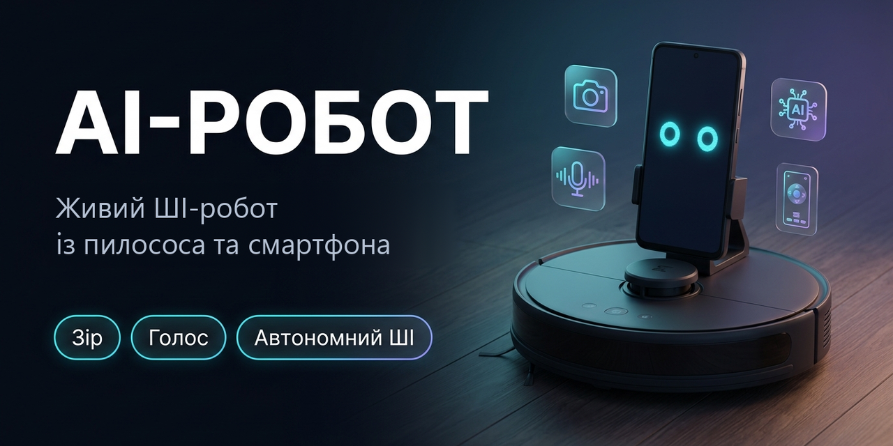
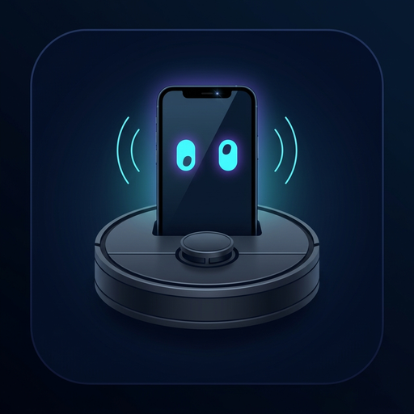
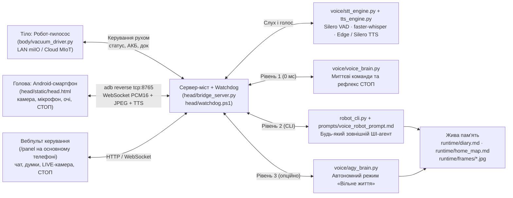

<p align="center">
  
</p>

<p align="center">
  
</p>

<h1 align="center">AI-Robot</h1>

<p align="center">
  <strong>Живий автономний ШІ-робот із звичайного робота-пилососа та старого Android-смартфона: комп’ютерний зір, локальний слух, спокійний голос, характер, особистий щоденник, карта оселі та покрокова інструкція для будь-якого ШІ-агента.</strong>
</p>

---

## Швидкий запуск через ШІ-агента (рекомендовано)

Проєкт спеціально спроєктований так, щоб **вам не довелося програмувати вручну** — достатньо передати цей репозиторій вашому ШІ-агенту (**Antigravity**, **Claude Code**, **Codex**, **Cursor** тощо):

1. Клонуйте або завантажте репозиторій на комп’ютер:
   ```bash
   git clone https://github.com/gulivermaks/AI-Robot.git
   cd AI-Robot
   ```
2. Відкрийте папку `AI-Robot` у своєму ШІ-агенті.
3. Надішліть йому промпт:

> Прочитай `AGENT_SETUP_GUIDE.md` і допоможи мені покроково налаштувати цього ШІ-робота під мій комп’ютер, мій смартфон і мій робот-пилосос. Спочатку постав мені запитання з Кроку 0.

Агент сам створить віртуальне середовище, встановить залежності, допоможе безпечно отримати токен пилососа через локальний QR-код Mi Home, під’єднає Android-смартфон через ADB, налаштує мову й голос та проведе з вами перший тестовий заїзд.

---

## Як це влаштовано

Система працює **без Docker, без Home Assistant, без VDO.Ninja та без локальних HTTPS-сертифікатів**. Зв’язок із телефоном-«головою» відбувається напряму через `adb reverse` + WebSocket (`http://localhost:8765`), тому Chrome на смартфоні автоматично довіряє камері, мікрофону з апаратним ехоподавленням (AEC) та динаміку.



---

## Основні можливості

- **Мінімальний поріг входу:** жодних громіздких контейнерів, віртуалок чи сторонніх хабів — лише Python 3.11–3.12, `adb` та звичайний Chrome на Android.
- **Тіло (`body/`):** підтримка роботів-пилососів **Xiaomi** з коробки по локальній мережі (`miIO AES-128-CBC` через UDP `54321`) з резервом через **Cloud MIoT**, вбудованим пошуком у LAN та безпечним входом через QR-код (`body/discover_xiaomi.py`). Для інших брендів достатньо реалізувати інтерфейс `VacuumDriver`.
- **Голова (`head/`):** старий Android-телефон перетворюється на «голову» робота — показує живі анімовані очі й кнопку екстреної зупинки **СТОП**, передає відеопотік із камери та аудіо з мікрофона (із підсилювачем `GainNode`) та автоматично відновлює WebSocket і камеру при коротких збоях зв’язку. Підтримується автопошук нового IP смартфона в локальній мережі за MAC-адресою (`adb_mac`).
- **Локальний слух і миттєвий рефлекс безпеки (`voice/stt_engine.py`):** `Silero VAD` відсікає тишу та фоновий шум, `faster-whisper` (на GPU NVIDIA CUDA або на CPU) розпізнає мовлення, а на стоп-слова (*«Стоп!»*, *«Стій!»*, *«Замри!»*) робот гальмує миттєво в робочому потоці аудіо — ще до звернення до LLM.
- **Природний голос (`voice/tts_engine.py`):** підтримка онлайн-голосів **Edge-TTS** (зокрема українські `uk-UA-PolinaNeural`, `uk-UA-OstapNeural` та інші мови) і повністю офлайн-синтезу **Silero TTS v5** із автоматичним зниженням частоти до 24 кГц у разі нестачі оперативної пам’яті.
- **Трирівневий мозок:**
  1. **0-мс локальний автопілот (`voice/voice_brain.py`)** — миттєво виконує базові команди руху, поворотів, статусу, прибирання та повернення на базу без витрати токенів LLM.
  2. **Зовнішній ШІ-агент (`robot_cli.py`)** — ваш улюблений агент бачить кадри з камери, планує маршрути, спілкується голосом і керує роботом за інструкцією `prompts/voice_robot_prompt.md`.
  3. **Опційний фоновий мозок (`voice/agy_brain.py`)** — автономний режим **«Вільне життя»**, коли робот самостійно досліджує кімнати за власним планом.
- **Вебпульт із вашого основного смартфона (`/panel`):** LIVE-перегляд камери, живі «думки» робота, текстовий чат, вибір моделі ШІ та інтервалу автономності, режим відгуку лише за іменем (`wake_word_only`), збереження історії подій (`panel_history.jsonl`), екстрений **СТОП** і автоматичний захист батареї (зупинка автономності при заряді ≤ 20%).
- **Жива пам’ять (`runtime/`):** робот веде власний щоденник вражень (`diary.md`) і карту кімнат/перешкод (`home_map.md`), що зберігаються між сесіями.
- **Надійність 24/7 (`head/watchdog.ps1`):** сторожовий скрипт для Windows автоматично перезапускає сервер і відновлює ADB-тунель після непередбачених збоїв.

---

## Що знадобиться

- **ПК або ноутбук** (Windows 10/11 перевірено з коробки; також працює на Linux і macOS) із Python **3.11–3.12** та Android SDK **Platform-Tools (`adb`)**. Відеокарта NVIDIA (від 4 ГБ VRAM) помітно прискорює STT, але проєкт стабільно працює й на звичайному процесорі (`CPU int8`).
- **Робот-пилосос** (для Xiaomi отримання токена через QR-код уже вбудоване; інші бренди легко підключаються через `VacuumDriver`).
- **Будь-який старий Android-смартфон** для «голови» (увімкнене налагодження по USB/Wi-Fi, встановлений Google Chrome, закріплений так, щоб **не перекривати башточки LiDAR** та передніх датчиків).
- **ШІ-агент** (Antigravity, Claude Code, Codex, Cursor тощо) для автоматичного налаштування або керування роботом.

---

## Структура проєкту

```text
AI-Robot/
├── AGENT_SETUP_GUIDE.md          # Покрокова інструкція для ШІ-агента (налаштування під вас)
├── README.md                     # Опис проєкту
├── config.example.json           # Шаблон конфігурації (скопіюйте в config.json)
├── requirements.txt              # Python-залежності
├── env_setup.py                  # Портативне налаштування шляхів, кешів (.cache/) та CUDA DLL
├── robot_cli.py                  # Єдиний CLI для ШІ-агента (step, listen, say, think, frame, status, stop, dock)
├── start.ps1 / stop.ps1          # Запуск (з watchdog) та зупинка на Windows PowerShell
├── body/
│   ├── discover_xiaomi.py        # Сканування Xiaomi у LAN (UDP 54321) + QR-авторизація Mi Home
│   └── vacuum_driver.py          # Драйвер пилососа (LAN miIO + Cloud MIoT fallback + self-test)
├── head/
│   ├── adb_setup.py              # Підключення Android через ADB, adb reverse tcp:8765, пошук IP за MAC
│   ├── bridge_server.py          # FastAPI + WebSocket сервер координації голови, тіла, STT/TTS та мозку
│   ├── watchdog.ps1              # Автоперезапуск bridge-сервера та ADB на Windows
│   └── static/
│       ├── head.html             # Екран «голови» (очі, камера, мікрофон, динамік, СТОП)
│       └── panel.html            # Вебпульт керування (/panel)
├── voice/
│   ├── stt_engine.py             # Silero VAD + faster-whisper + миттєвий рефлекс СТОП
│   ├── tts_engine.py             # Edge-TTS (онлайн) + Silero TTS v5 (офлайн, fallback 24 кГц)
│   ├── voice_brain.py            # Локальний 0-мс парсер команд руху, статусу, бази, прибирання
│   └── agy_brain.py              # Опційний вбудований мультимодальний мозок через Antigravity CLI (agy)
├── prompts/
│   └── voice_robot_prompt.md     # Системний промпт для зовнішнього ШІ-агента
├── docs/
│   ├── banner.png                # Банер проєкту
│   └── logo.png                  # Логотип проєкту
└── runtime/
    ├── diary.example.md          # Шаблон особистого щоденника робота
    ├── home_map.example.md       # Шаблон карти оселі та орієнтирів
    └── frames/.gitkeep           # Директорія для свіжих знімків із камери
```

---

## Ручне встановлення (без ШІ-агента)

Якщо ви хочете розгорнути проєкт самостійно:

1. Створіть віртуальне середовище Python 3.11–3.12 та встановіть залежності:
   ```powershell
   python -m venv .venv
   .\.venv\Scripts\python.exe -m pip install --upgrade pip
   .\.venv\Scripts\python.exe -m pip install -r requirements.txt
   ```
   *(Якщо є відеокарта NVIDIA з CUDA 12, додатково виконайте: `.\.venv\Scripts\python.exe -m pip install nvidia-cublas-cu12 nvidia-cudnn-cu12`.)*
2. Скопіюйте шаблони конфігурації та пам’яті:
   - `config.example.json` → `config.json`
   - `runtime/diary.example.md` → `runtime/diary.md`
   - `runtime/home_map.example.md` → `runtime/home_map.md`
3. Знайдіть пилосос Xiaomi і збережіть токен у `config.json`:
   ```powershell
   .\.venv\Scripts\python.exe body\discover_xiaomi.py --scan-only
   .\.venv\Scripts\python.exe body\discover_xiaomi.py --qr --open
   ```
4. Перевірте драйвер і підключення Android-телефона через `adb devices`, після чого запустіть систему:
   ```powershell
   .\start.ps1
   ```
   *(На Linux/macOS запустіть `python -m head.bridge_server` та `python head/adb_setup.py`.)*
5. Перевірте готовність:
   ```powershell
   .\.venv\Scripts\python.exe robot_cli.py health
   .\.venv\Scripts\python.exe robot_cli.py status
   .\.venv\Scripts\python.exe robot_cli.py frame
   ```

Детальніші налаштування моделей, мови, калібрування шасі та розв’язання типових проблем дивіться в [AGENT_SETUP_GUIDE.md](AGENT_SETUP_GUIDE.md).

---

## Приватність і безпека

Проєкт налаштований через `.gitignore` так, щоб **жодні персональні дані чи секрети ніколи не потрапили до Git**:

- `config.json` (токен пилососа, `did`, локальні IP, MAC-адреси) залишається виключно у вас на диску;
- `.cache/` (сесії Mi Home, список пристроїв, локальні моделі Whisper/Silero) не індексується;
- `runtime/frames/*.jpg`, `runtime/diary.md`, `runtime/home_map.md`, `runtime/inbox.jsonl`, `runtime/panel_history.jsonl` та логи залишаються приватними.

---

## Ліцензія

Проєкт поширюється на умовах ліцензії [MIT](LICENSE).

---

## Подяка та спільнота

Дякую автору YouTube-каналу **[LINNIK X](https://www.youtube.com/@LinnikX)** за натхнення до створення цього проєкту.

Обговорити цей та інші ШІ-проєкти можна у Telegram-групі **LINNIK X** — [@linx_chatai](https://t.me/linx_chatai).
